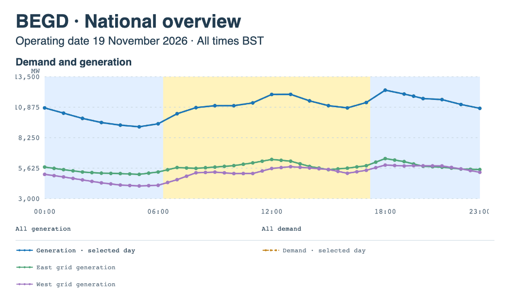
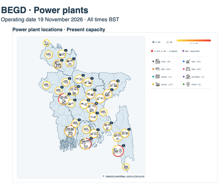

# Bangladesh Electric Grid Dashboard (BEGD)

[](https://satyakibanik.github.io/Projects/begd/) [](LICENSE.md)

BEGD is an independent website for exploring Bangladesh’s electricity grid. It brings together daily operating reports, recent ERP readings, historical trends, maps, and forecasts for demand, generation, load shedding, and cross-border imports.

[Open the dashboard](https://satyakibanik.github.io/Projects/begd/)

[](https://satyakibanik.github.io/Projects/begd/#overview)

*National Overview · Operating date 19 November 2026 (Bangladesh time).*

## Data sources

| Data | Source |
| --- | --- |
| Daily grid operations | Power Grid Bangladesh PLC and the National Load Dispatch Centre (NLDC). Workbooks cover national and regional operations, generation and fuel mix, plants, imports, substations, outages, interconnector flows, and generation availability. [Daily report archive](https://erp.powergrid.gov.bd/w/report/eyJpdiI6IldsU2ZQTGkvbkRnQU9FMjZ5UHhmeGc9PSIsInZhbHVlIjoiQzhONVl5ZGxRY3E3T3ZVNCtLZGt1Zz09IiwibWFjIjoiN2JiNTI5MzNhOWIxZDVjY2NkMmFlZWU4ZDU1N2I4OWZlYjNlZWM1ZGU4NzRiNWU4ZjQ3ZDc1ODRlMTk3MDc0YyIsInRhZyI6IiJ9/show_report) |
| Real-time readings and record comparisons | Power Grid ERP. [Demand, supply and load shedding](https://erp.powergrid.gov.bd/web/generations/view_demand_supply_loadshed) · [Generation by source](https://erp.powergrid.gov.bd/w/generations/view_generations) · [India imports](https://erp.powergrid.gov.bd/w/generations/imported_power_india) · [Maximum generation](https://erp.powergrid.gov.bd/w/maximum_generations/show_maximum_generations) |
| Generation costs, system losses, and grid development | [BPDB daily generation reports](https://misc.bpdb.gov.bd/daily-generation-archive) · [Power Division / Power Cell system-loss statistics](https://powerdivision.gov.bd/pages/static-pages/694032ba35ce18e1c056155a) · [Power Grid annual report](https://erp.powergrid.gov.bd/web/files/download?location=erp%2Fweb%2Freport_docs%2F4755.pdf) |
| Long-run generation history | BengalGrid v2 by Md Abir Rahman and Rafi Ahamed, under CC BY 4.0. [Dataset and DOI](https://doi.org/10.17632/xx9dhmy9rj.2) |
| Gas and coal | Petrobangla daily gas supply and allocation, GTCL operational reports for comparison, and BCMCL annual Barapukuria coal production. [Petrobangla](https://petrobangla.org.bd/pages/reports?filters=%7B%22reports_type%22%3A%20%226922d2b181fc96cef9e99f16%22%7D) · [GTCL](https://gtcl.gov.bd/pages/reports?filters=%7B%22reports_type%22%3A%20%226922d2b181fc96cef9e99f16%22%7D) · [BCMCL](https://bcmcl.org.bd/pages/static-pages/6922dd3c933eb65569e140ed) |
| Administrative boundaries | The bundled Bangladesh outline uses geoBoundaries-derived upazila geometry. District outlines use geoBoundaries ADM2 data from the Bangladesh Bureau of Statistics and OCHA ROAP. Division outlines follow the district-to-division hierarchy. [Bangladesh GeoJSON](https://github.com/ifahimreza/bangladesh-geojson) · [geoBoundaries](https://www.geoboundaries.org/api/current/gbOpen/BGD/ADM2/) |
| Infrastructure coordinates | Plant locations use manually reviewed OpenStreetMap matches and coordinate corrections. The east–west flow map uses reviewed substation endpoints with schematic connections. Mapped import routes use OpenStreetMap geometry. [OpenStreetMap](https://www.openstreetmap.org/copyright) · [OpenInfraMap](https://openinframap.org/) · [Overpass Turbo](https://overpass-turbo.eu/) |
| BEGD forecasts | Dashboard-generated demand and generation forecasts use historical ERP readings, workbook data, and weather forecast inputs. [Forecast methodology](https://github.com/satyakibanik/Projects/tree/main/research/erp-independent-forecasts) · [Open-Meteo Previous Runs API](https://open-meteo.com/en/docs/previous-runs-api) |
| News and institutions | News uses English and Bangla RSS feeds from The Business Standard, The Daily Star, Prothom Alo, Bangla Tribune, and Jagonews24. The organogram draws on official ministry, regulator, and utility portals linked in the view. |

## Update frequency

- **Grid data and news** are checked by GitHub Actions every 15 minutes. GitHub can delay scheduled builds, and new readings appear after a successful deployment. Open Real time and News tabs check for new published snapshots every three minutes.
- **Daily workbooks and fuel reports** follow their publishers’ schedules. **BPDB costs** are checked at most every six hours and **system-loss statistics** at most every 30 days. **BEGD forecasts** are published by operating day.
- **Map geometry, reviewed coordinates, the organogram, and the BengalGrid release** change with source or catalog revisions. All operating dates and times use Bangladesh time (Asia/Dhaka). Operating and publication dates can differ.

## Explore the dashboard

[](https://satyakibanik.github.io/Projects/begd/#plants)

*Power plants · Operating date 19 November 2026 (Bangladesh time).*

Open the map to browse plants by fuel, compare available capacity, and inspect hourly output.

## Dashboard tabs

| Tab | What’s inside |
| --- | --- |
| [Real time](https://satyakibanik.github.io/Projects/begd/#realtime) | Latest ERP demand, supply, load shedding, generation mix, India imports, and BEGD forecasts. |
| [Long-term trends](https://satyakibanik.github.io/Projects/begd/#trends) | Daily and historical electricity trends, generation costs, system losses, and an operational event explorer. |
| [Overview](https://satyakibanik.github.io/Projects/begd/#overview) | Daily briefing, hourly demand and generation, peak conditions, fuel mix, and reported energy totals. |
| [Energy Curve](https://satyakibanik.github.io/Projects/begd/#en-curve) | Half-hourly generation by source and reported shortage, plus daily BPDB costs when a matching report is available. |
| [Regions](https://satyakibanik.github.io/Projects/begd/#regions) | Regional generation and energy mix, evening-peak demand, and load shedding. |
| [Power plants](https://satyakibanik.github.io/Projects/begd/#plants) | Searchable map and table with fuel, capacity, status, and hourly unit output. |
| [Insight](https://satyakibanik.github.io/Projects/begd/#insight) | Exploratory operating metrics and interactive grid scenarios. |
| [Imports](https://satyakibanik.github.io/Projects/begd/#imports) | Hourly power and daily energy by cross-border route, plus import share. |
| [Substations](https://satyakibanik.github.io/Projects/begd/#substations) | Maximum served load and daily voltage ranges for 400, 230, and 132 kV stations. |
| [Operations](https://satyakibanik.github.io/Projects/begd/#operations) | Planned and forced shutdowns, event logs, and east–west interconnector flows. |
| [Forecast](https://satyakibanik.github.io/Projects/begd/#forecast) | Official generation availability, BEGD demand and generation forecasts, and comparisons with published scenarios and actuals. |
| [Fuel](https://satyakibanik.github.io/Projects/begd/#fuel) | Daily gas supply, power-sector allocations, and annual Barapukuria coal production. |
| [News](https://satyakibanik.github.io/Projects/begd/#news) | Searchable English and Bangla power-sector news with links to publishers. |
| [Organogram](https://satyakibanik.github.io/Projects/begd/#organogram) | Institutional roles and links to official data across the electricity, fuel, and nuclear sectors. |

## License and attribution

Original project code is licensed under [GNU GPL v3.0](LICENSE.md). Third-party materials retain their source terms. OpenStreetMap data is © OpenStreetMap contributors under ODbL. geoBoundaries distributes its data under CC BY 4.0, and the underlying district data carries CC BY 3.0 IGO.

BEGD is an unofficial reference for informational use. Consult the original operating reports for authoritative figures.

## Suggested citation

> Banik, Satyaki. *Bangladesh Electric Grid Dashboard (BEGD).* Accessed [date]. [Dashboard](https://satyakibanik.github.io/Projects/begd/).

For a specific figure, include its operating date and cite the underlying report or dataset.

## Development

The [BEGD developer guide](begd/README.md) covers local previews, deployed data files, and calculation conventions. Run the local checks from the repository root.

```sh
python -m pip install -r requirements.txt
python -m unittest discover -s tests -p 'test_*.py'
node --test tests/*.test.cjs
```
